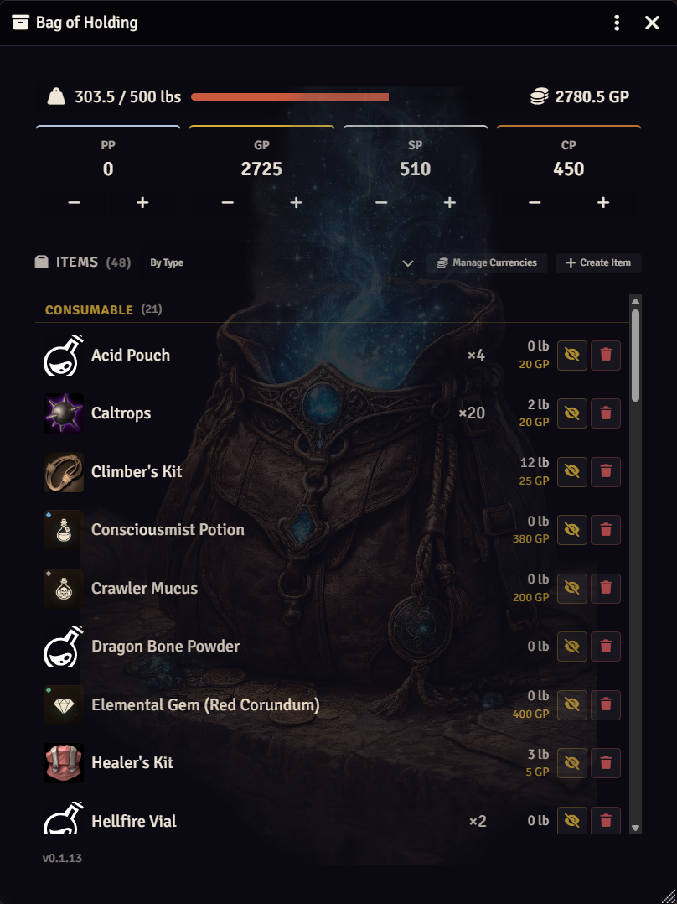
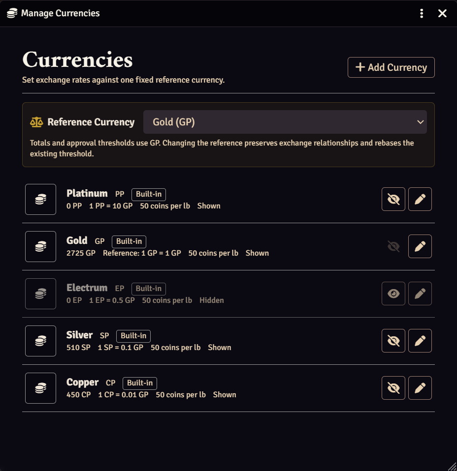
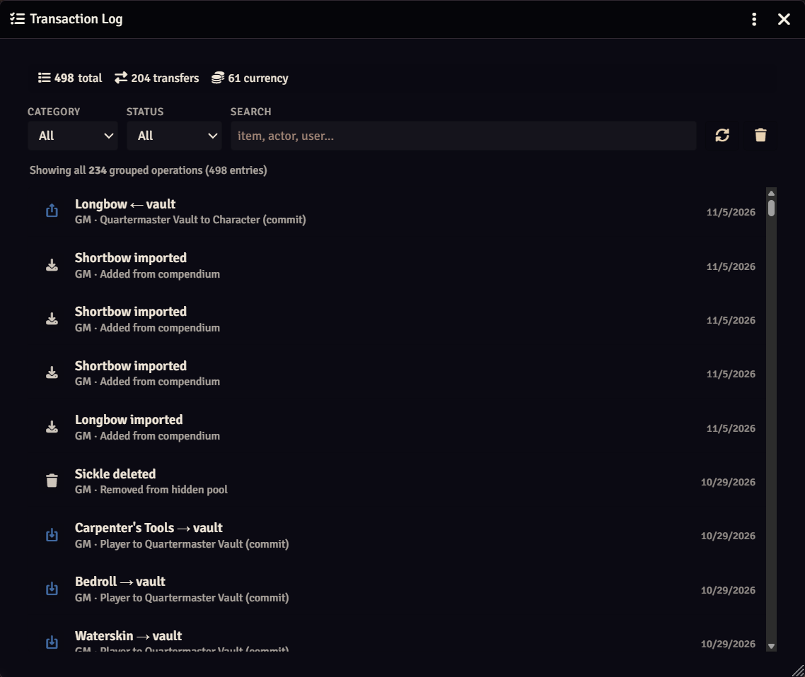

# Quartermaster

Quartermaster is a system-agnostic shared party inventory and resource ledger for Foundry Virtual Tabletop.

It gives a group one persistent vault for visible items, balances, resources, and an audit trail, plus a private GM staging area for unrevealed loot and recovery records. Quartermaster tracks what the party owns and how that changed over time; it does not replace map-based loot piles, merchants, or treasure chests.

[Install in Foundry](#installation) · [Latest release](https://github.com/Lipton1010/quartermaster/releases/latest) · [Compatibility](#compatibility) · [Support development](https://ko-fi.com/paulmiscavage)



*Quartermaster v0.1.13 running on Foundry VTT 14.370 with D&D 5e 6.1.1.*

### One place for the party's shared gear

- **Share the haul.** Move items between character sheets and the party stash.
- **Prepare the next encounter.** Stage loot privately, then reveal it when the party finds it.
- **Follow the money.** Track standard and custom currencies alongside consumable resources.
- **Keep the history.** Review who changed the inventory in a searchable transaction log.

<details>
<summary>Currency Manager and Transaction Log screenshots</summary>





Player and character names in the transaction log have been anonymized.

</details>

[Browse the screenshot gallery](screenshots/) · [Read the changelog](CHANGELOG.md)

## v1.0 release-candidate status

This 1.0.0 test candidate incorporates the v0.1.15 release line. Its primary live target is Foundry 14.370 with D&D5e 6.1.1. The previous six-system/version matrix and v0.1.8 migration rehearsal used an earlier package. The current build needs a fresh v0.1.15 upgrade rehearsal and live client checks. See the [release gate](docs/RELEASE-GATE.md).

## System support

- **D&D 5e:** full native PP/GP/EP/SP/CP support, item quantity, weight, value, and identification metadata. Existing 500 lb default capacity behavior is preserved.
- **Pathfinder 2e:** native coin support, loot actors, quantity, Bulk, value, identification metadata, and coin-item filtering. Quartermaster separates canonical coin Bulk from the Actor inventory aggregate so optional currency load is not counted twice. Coin Items inside Bulk-reducing containers can make that separation approximate; capacity enforcement is disabled initially, and this case remains a required live check.
- **Other systems:** a safe generic adapter preserves complete Item data and supplies one editable `Currency` (`CUR`) custom balance. Unsupported weight, value, and identification fields are omitted instead of displayed as zero.
- **Third-party integrations:** modules may register adapters during the `quartermaster.registerSystemAdapters` hook or through `game.modules.get("quartermaster").api.system.registerAdapter(...)`.

If a generic system exposes more than one usable Actor type, a GM chooses the vault type during setup. Quartermaster stores that choice for the world and fails safely when no compatible type exists.

## Features

- Shared party inventory available from the Actors sidebar or optional scene shortcut token
- Whole-document Item transfers between the vault and compatible Actors owned by the requesting user
- Support for linked Actors and unlinked Token Actors through document UUIDs
- D&D 5e and PF2e native currency, plus unlimited custom currencies
- Configurable exchange rates, currency visibility, approval thresholds, and optional custom-currency load
- Custom counter resources, inventory sorting, and transaction history
- Directory-row and sheet-wide drops from the inventory or Loot Prep to compatible actors
- GM Loot Prep with collapsible folders, inherited notes, staged currency, compendium imports, and bulk reveal
- A GM-only staging Actor for hidden loot, notes, canonical logs, and failed-transfer recovery records
- Capacity/load display only when the active system adapter can provide accurate metadata
- Restartable v0.1.8-to-v1 storage migration that copies and verifies data before removing legacy values

Whole Item documents or stacks transfer together. In D&D5e, remove an item from its container before moving it individually and empty a container before transferring it. During migration, mark the container and its contents for the same storage actor to preserve their links. Partial-stack transfers and automatic conversion of a world from one game system to another are outside the v1 scope.

## Requirements

- Foundry VTT v13 or v14
- A game system with at least one Actor type capable of holding embedded Items

D&D5e 6.1.1 requires Foundry 14.367 or newer. Use a compatible D&D5e 5.x release for Foundry 13.

## Installation

The [current published release](https://github.com/Lipton1010/quartermaster/releases/latest) is available in the Foundry package browser. For this local test build, extract the supplied ZIP into an isolated Foundry data path under `Data/modules/` and open a disposable copy of a v0.1.15 world. The ZIP already contains the `quartermaster/` directory.

## Migration and privacy

On first GM startup, v1 creates a player-readable shared vault and a separate GM-only staging Actor. Legacy hidden Items, staged currency, folders, notes, and canonical logs are copied to private storage, verified, and only then removed from their legacy location. A schema marker advances only after the complete migration succeeds, so an interrupted migration can be run again safely. Recovery records are a new v1 concept written when a v1 transfer needs one; v0.1.8 has no recovery data to migrate.

Visible Items, balances, resources, redacted log entries, settings, and shortcut-token links remain available to players as before. Disabling Quartermaster does not delete either storage Actor.

Never test migration against the only copy of a production world. Clone the world or use a synthetic fixture.

## Macro and integration API

The documented inventory macro remains stable:

```js
await game.modules.get("quartermaster").api.ui.openInventory();
```

The existing currency, resource, and transaction-log API facades remain available. Adapter integrations can register during setup:

```js
Hooks.on("quartermaster.registerSystemAdapters", ({ registerAdapter }) => {
  registerAdapter("my-system", myAdapter);
});
```

An adapter registration is versioned and validated; invalid adapters are rejected without replacing the generic fallback.

## Security model

Player mutations use Foundry's authenticated query transport. Quartermaster fails closed if that transport is unavailable; it does not accept unauthenticated raw-socket mutation messages. The active GM re-checks sender identity, ownership, transfer direction, system compatibility, and storage boundaries before changing documents.

Transfers preflight and create the destination Item before deleting the source. If reconciliation cannot complete, the private staging Actor retains a recovery record for a GM.

## Development and release checks

```text
npm test
npm run package
```

The package command builds the committed tree and emits a ZIP, manifest, SHA-256 checksum and contents list under `../../artifacts/system-agnostic/`. Test the packaged ZIP for the final GM/player and migration checks.

## Compatibility

Quartermaster can coexist with map-loot modules such as Item Piles because it uses its own Actors and `flags.quartermaster` namespace. Do not configure either Quartermaster storage Actor as an Item Piles pile.

## License

MIT — see [LICENSE](LICENSE).

## Author

Paul Miscavage — [GitHub](https://github.com/Lipton1010)
